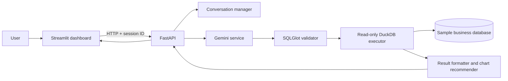

# QueryPilot AI

QueryPilot AI turns plain-English business questions into DuckDB SQL, checks each query, runs it against a read-only database, and presents its results in a Streamlit dashboard. The data is synthetic and intended for local demonstration.

## Features

- FastAPI service with schema, health, query, SQL editor, and per-session history endpoints.
- Gemini SQL generation using Google's current `google-genai` SDK (`genai.Client` and `models.generate_content`).
- SQLGlot parsing, single-SELECT policy, table allowlist, catalog/function guards, planner-based column resolution, and DuckDB read-only execution.
- CSV and Excel dataset uploads into queryable DuckDB tables, repeatable sample database initialization, conversational context, capped results, CSV export, and Plotly chart recommendations.
- Tests mock Gemini and do not require a live API key.

## Architecture



## Stack

Python 3.12+, Streamlit, FastAPI, Google Gen AI SDK, DuckDB, Pandas, Plotly, Pydantic, SQLGlot, pytest, Docker Compose.

## Project structure

```text
app.py                         Streamlit UI
backend/main.py                FastAPI application
backend/api/routes.py          HTTP endpoints
backend/core/                  Settings and logging
backend/database/              DuckDB access and initialization
backend/services/              LLM, validation, execution, history, charts
backend/models/                 Request and response models
tests/                          Offline automated tests
scripts/                        Database setup command
data/                           Local database location
```

## Setup: Windows PowerShell

Use Python 3.12 or newer.

```powershell
py -3.12 -m venv .venv
.\.venv\Scripts\Activate.ps1
python -m pip install --upgrade pip
pip install -r requirements.txt
Copy-Item .env.example .env
notepad .env
python -m backend.database.init_db
```

Set `GEMINI_API_KEY` in `.env` using a key from Google AI Studio. The app never prints or displays the key. The database, health endpoint, and SQL editor can still be used without a key; natural-language generation displays a configuration message until a key is configured.

### Linux/macOS

```bash
python3.12 -m venv .venv
source .venv/bin/activate
pip install -r requirements.txt
cp .env.example .env
python -m backend.database.init_db
```

## Run locally

Open two terminals from the project root, with the virtual environment activated in each:

```powershell
uvicorn backend.main:app --reload --port 8000
```

```powershell
streamlit run app.py
```

Open the Streamlit URL printed in the terminal (usually `http://localhost:8501`). FastAPI docs are at `http://localhost:8000/docs`.

## Docker

Create `.env` as above, then run:

```powershell
docker compose up --build
```

The dashboard is on port 8501 and API on port 8000. The named Docker volume persists the generated database. The included single-container setup is for a local demo; for public deployment use TLS, authentication, a private network for the API, and a durable database volume.

## API

| Method | Path | Purpose |
| --- | --- | --- |
| GET | `/health` | Database readiness |
| GET | `/schema` | Tables, columns, relationships, business definitions |
| POST | `/datasets/upload` | Import a CSV or Excel file as a table (multipart fields: `file`, optional `table_name`; 25 MB limit) |
| POST | `/query` | Generate, validate, and execute a question (`{"question":"Show revenue by category"}`) |
| POST | `/query/sql` | Validate and execute user SQL (`{"sql":"SELECT city FROM customers"}`) |
| GET | `/history` | Current session history |
| DELETE | `/history` | Clear current session history |

Send `X-Session-ID` to identify a browser session. The Streamlit client generates a random ID. History is memory-only and bounded to the latest 20 entries.

## Example questions

- “Show the top 5 customers by total spending” — joins customers and orders, groups by customer, sorts descending, and limits results.
- “What is revenue by product category?” — joins orders, order items, and products and aggregates sales.
- “Show monthly sales for completed orders” — groups completed orders by month.
- “Only include Bengaluru” — follow-up context is included in generation; the model still has to produce a complete query that is revalidated.

The specific SQL depends on the configured Gemini model. The database has `customers`, `products`, `orders`, and `order_items`; all values are synthetic.

## Security design

The generated query is treated as untrusted. SQLGlot requires one SELECT statement, rejects unavailable tables and catalog-qualified access, and blocks known external data functions. DuckDB's planner resolves identifiers, and query execution uses a read-only database connection. Dataset uploads are size limited and create a new table; an existing table name is rejected to protect existing data. Results are capped by `MAX_RESULT_ROWS`. Natural-language requests never pass directly to SQL execution. The current demo does not provide user authentication; do not expose it publicly without adding authentication and network protections.

## Tests

```powershell
python -m pytest tests -q -p no:cacheprovider
```

Tests initialize the local sample database and mock Gemini; they do not make external service calls. Run database setup before manually starting the API:

```powershell
python scripts/initialize_database.py
```

## Configuration

| Variable | Default | Purpose |
| --- | --- | --- |
| `GEMINI_API_KEY` | empty | Google AI Studio API key |
| `GEMINI_MODEL` | `gemini-2.5-flash` | Gemini model name |
| `DATABASE_PATH` | `./data/querypilot.duckdb` | DuckDB file |
| `BACKEND_URL` | `http://localhost:8000` | Streamlit's backend URL |
| `MAX_RESULT_ROWS` | `1000` | Maximum rows returned |
| `QUERY_TIMEOUT_SECONDS` | `10` | Interrupts a running DuckDB query after this many seconds |

## Troubleshooting

- **Database unavailable:** Run `python -m backend.database.init_db`, then restart FastAPI.
- **Gemini not configured:** Set `GEMINI_API_KEY` in `.env` and restart Streamlit/backend.
- **Backend unavailable in UI:** Start `uvicorn backend.main:app --reload --port 8000` and check `BACKEND_URL`.
- **PowerShell activation blocked:** Run `Set-ExecutionPolicy -Scope Process -ExecutionPolicy Bypass` in that terminal, then activate the venv.
- **Port occupied:** Choose another port and update `BACKEND_URL` to match.

## Deployment notes

Build with Docker Compose for a local or private-network demonstration. Configure secrets through the deployment platform's secret manager, set a persistent volume for DuckDB, terminate TLS at a trusted proxy, and add authentication before exposing endpoints to untrusted users.
